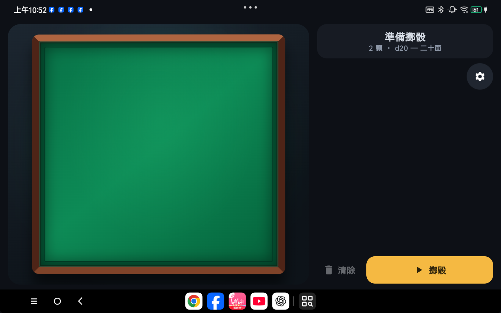
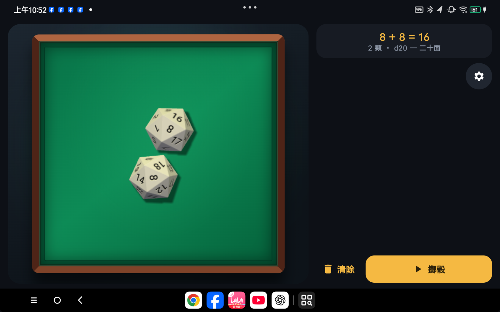
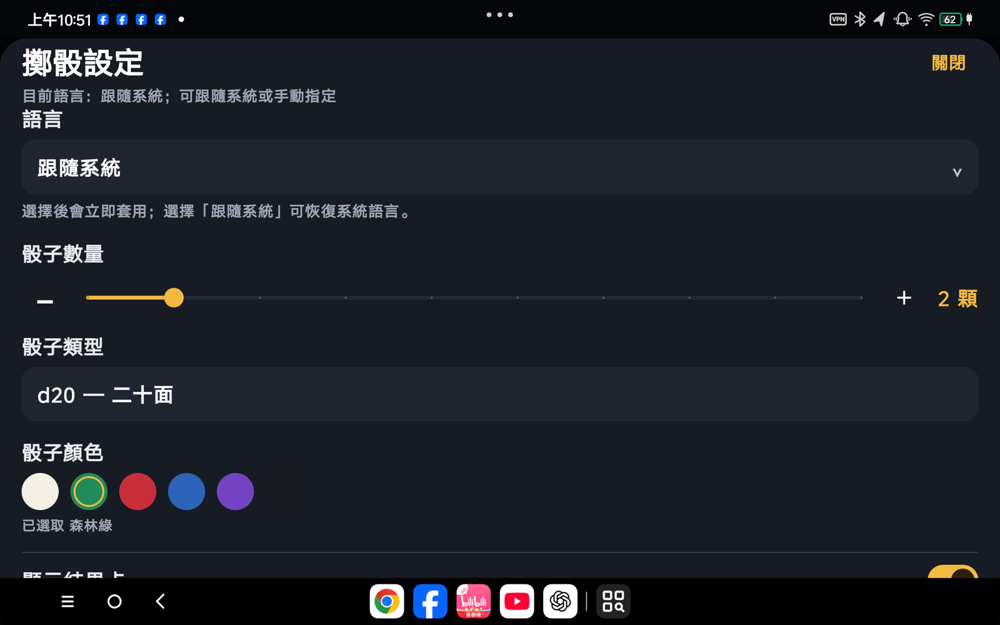
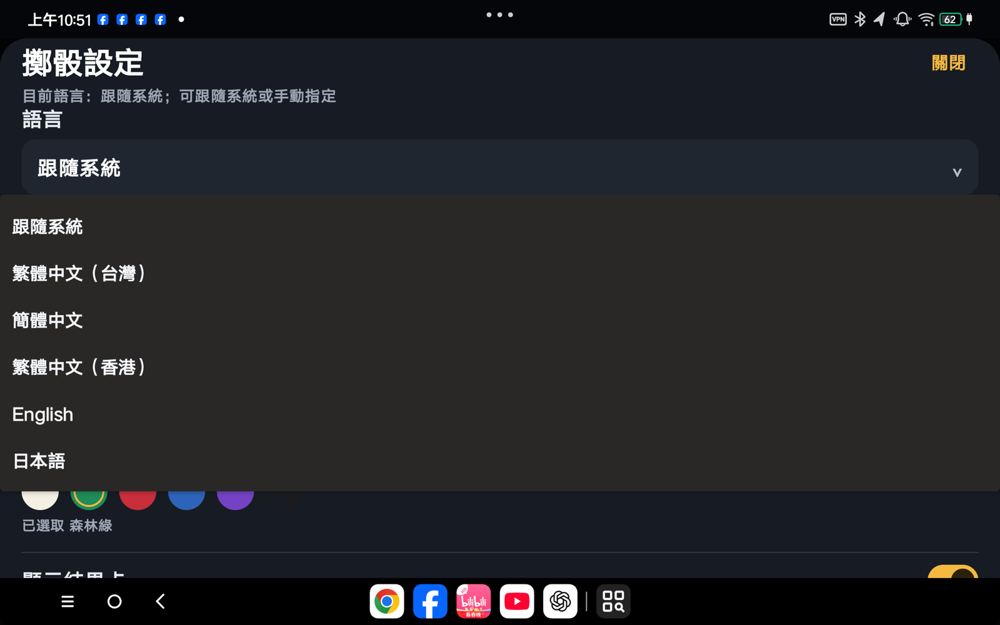

# Dice Tray

Dice Tray is an Android 3D dice app built with Jetpack Compose, WebView, and Three.js-based physics rendering. Dice roll on a tray with gravity, wall contacts, and die-to-die collisions, while the layout adapts to phones, tablets, and wide screens.

[繁體中文](README.md) · [简体中文](README.zh-CN.md) · [日本語](README.ja.md)

## Features

- D4, D6, D8, D10, D12, and D20.
- D6 uses pip faces; other dice use numbered faces.
- Roll 1–10 dice at a time.
- Tap the tray or the Roll button to roll, and clear the scene when needed.
- Cannon physics for die-to-die, tray, and boundary collisions.
- Gravity-sensor-based horizon correction keeps the tray background and dice projection aligned to a horizontal real-world plane.
- Optional phone tilt/shake physics, vibration, motion trails, result card, and dice colors.
- Motion sensitivity from 0.5x to 3.0x, with a default of 2.2x.
- Traditional Chinese, Simplified Chinese, Hong Kong Traditional Chinese, English, and Japanese. The app can follow the system language or use a manual override.
- Responsive phone, tablet, and wide-screen layouts.

## Screenshots from a real device

<p align="center">
  
  
</p>
<p align="center">
  
  
</p>

These screenshots were captured on a physical Android tablet and show the responsive layout, Cannon collisions, settings panel, and system/manual language selection.

## Architecture

```text
Compose UI
  └─ DiceRollerViewModel + StateFlow
       ├─ DiceSettingsRepository + Preferences DataStore
       └─ DiceWebScene (WebView)
            ├─ WebViewAssetLoader (offline local assets)
            ├─ JavaScript bridge (roll, clear, motion, events)
            └─ Three.js + dice-box-threejs + Cannon.js
```

- Kotlin owns settings, random results, UI state, sensor lifecycle, and Compose UI.
- The WebView loads only APK-local files from `app/src/main/assets/dice/`; it does not require a network connection.
- `dice-box-threejs` and Cannon.js own the physical dice world. Android sensor data is display-rotation corrected and low-pass filtered before reaching the scene.
- Release builds enable R8 and resource shrinking while keeping the `@JavascriptInterface` bridge entry points.

## Requirements

- JDK 17.
- Android SDK 35.
- Android API 26 (Android 8.0) or newer.
- The repository includes a Gradle Wrapper, so a separate Gradle installation is not required.

## Build and test

```bash
./gradlew :app:testDebugUnitTest
./gradlew :app:assembleDebug
./gradlew :app:assembleRelease
```

The debug APK is written to `app/build/outputs/apk/debug/app-debug.apk`.

```bash
adb install -r app/build/outputs/apk/debug/app-debug.apk
```

## Sensor and AR limitations

Automatic horizon correction uses the gravity sensor and accelerometer, so the virtual tray stays level relative to real-world gravity. This is not ARCore plane tracking: the app does not currently track camera position, real table depth, occlusion, or full world-space parallax. A future anchored-on-the-real-table experience would require ARCore or another AR plane-tracking solution.

## Privacy and permissions

The app currently requests only vibration permission. Sensor values are used locally during the app session for physics and view correction; they are not uploaded, no account is required, and the app does not request camera or network permissions. Settings are stored in Android Preferences DataStore and local SharedPreferences.

## License

Original project code is released under the [MIT License](LICENSE). Three.js, Cannon.js, dice-box-threejs, and other bundled assets remain subject to their respective upstream licenses and copyright notices. Keep the license headers in those assets when redistributing them.

